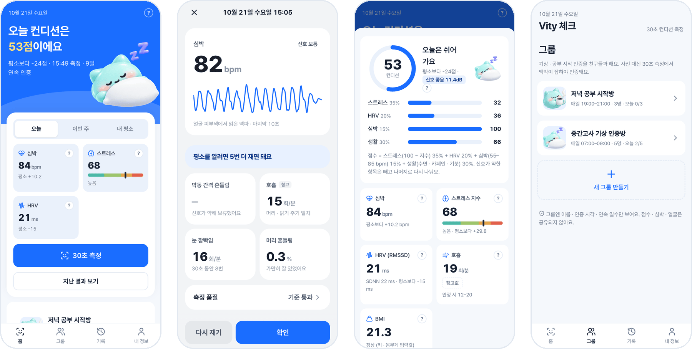
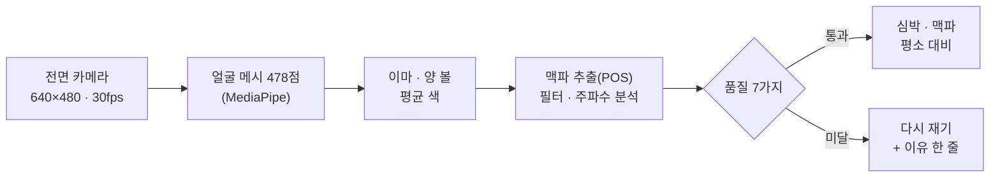

<div align="center">


# Vity

**시험기간, 30초 얼굴 스캔으로 보는 오늘 컨디션**

휴대폰 전면 카메라로 얼굴을 30초 찍으면 브라우저 안에서 심박, 맥파(rPPG), 박동 간격(HRV), 호흡을 계산합니다.<br>
신호 품질 기준 일곱 가지를 넘은 측정만 숫자로 보여 주고, 영상은 기기 밖으로 내보내지 않습니다.

[](https://github.com/dlwldn4824/capstone_best/actions/workflows/ci.yml)

Team 삼삼오오 캡스톤



</div>

## 하는 일

시험기간 대학생이 아침이나 공부를 시작하기 전에 30초 재고, 오늘 어떻게 공부할지 정하는 데 씁니다.

1. 어젯밤 잔 시간, 커피 잔 수, 지금 기분을 고릅니다.
2. 얼굴을 화면의 타원에 맞추면 측정이 저절로 시작되고, 이마와 양 볼의 색 변화로 읽은 심박이 실시간으로 나옵니다.
3. 결과에서 컨디션 점수와 심박, 신호 세기, 내 평소와의 차이를 봅니다. 점수는 계산식을 화면에 그대로 보여 줍니다. 박동 간격 · 스트레스 · 호흡은 신호가 충분할 때만 나옵니다.
4. 결과에 맞는 공부 모드(집중 · 휴식 시간)를 추천받습니다. 스트레스가 높게 나오면 1분 호흡을 하고 다시 재서 전후를 비교합니다.
5. 스터디 그룹 친구들과 기상 · 공부 시작을 인증합니다.

## 품질 기준을 넘은 측정만 숫자로 보여 줍니다

얼굴 영상으로 재는 심박은 조명과 움직임에 크게 흔들립니다. 팀이 공개 데이터 MCD-rPPG(100명, 정면 웹캠)로 돌려 보니 전체 평균 오차가 12 bpm 안팎이었고, 신호 세기(SNR)가 높은 측정일수록 오차가 작았습니다.

| 20초 구간의 SNR | 평균 오차 | ±5 bpm 안에 든 비율 |
| --- | --- | --- |
| −2 dB 미만 | 16.3 bpm | 57% |
| −2–0 dB | 9.4 bpm | 78% |
| 0–2 dB | 4.2 bpm | 91% |
| 2–4 dB | 1.5 bpm | 97% |
| 4 dB 이상 | 0.2 bpm | 100% |

<sub>손끝 PPG를 정답으로 잰 결과입니다. `research/scripts/24_mcd_analysis.py`, 자세한 결과는 [FACE_RPPG.md](docs/research/FACE_RPPG.md)</sub>

그래서 Vity는 측정이 끝나면 일곱 가지를 확인하고, 하나라도 못 넘으면 숫자 대신 "다시 재기"와 이유 한 줄을 보여 줍니다.

| 확인하는 것 | 걸러 내는 상황 |
| --- | --- |
| 얼굴 밝기 | 어두운 방, 역광 |
| 머리 움직임 | 손에 든 휴대폰의 흔들림 |
| 깜빡임 · 말하기 | 눈과 입 주변의 색 변화 |
| 신호 세기(SNR) | 맥박이 잡음에 묻힌 측정 |
| 얼굴이 잡힌 시간 | 얼굴을 놓쳐 심박이 낮게 나오는 것 |
| 간섭 | 화면 깜빡임이나 끄덕임의 주기를 심박으로 읽는 것 |
| 세 영역의 합의 | 이마 · 양 볼 중 한 곳에만 생긴 가짜 맥박 |

맥파는 처음부터 6초 구간마다 이마 · 양 볼(ROI) 중 신호가 좋은 영역에 무게를 두어 합칩니다. 그래도 기준을 못 넘으면 적응 필터(NLMS)로 얼굴 움직임 성분을 빼고 다시 판정합니다. 마지막으로 30초 안에서 깨끗한 15초 구간을 찾되, 다른 구간도 같은 심박을 가리킬 때만 그 값을 씁니다. 기준값은 [FACE_DESIGN.md](docs/app/FACE_DESIGN.md)에 있습니다.



## 연구에서 앱으로

| 공개 데이터에서 확인한 것 | 앱에서 |
| --- | --- |
| 안정 · 운동 후 영상을 사람끼리 비교하면 얼굴 심박으로는 우연 수준이었다(AUC 0.55). 같은 사람의 두 영상을 비교하면 운동 후를 62% 맞혔다(p = 0.027) | 결과를 "내 평소 대비"로 말하고, 기록이 쌓이기 전에는 평소를 말하지 않습니다 |
| 안색(붉은 기)은 운동 전후를 가르지 못했다 (52%, p = 0.71) | 안색은 화면에 넣지 않았습니다 |
| 손목 PPG의 RMSSD는 같은 시각 가슴 ECG보다 3.6배 크게 나왔다 (WESAD 15명) | 박동 간격은 SNR 10 dB 이상, 이웃 박동 쌍 20개 이상일 때만 보여 줍니다 |

웨어러블 데이터 세 개(Hongn 2025, Nurse Stress 2022, WESAD 2018)로 한 연구 전체는 [research/README.md](research/README.md)에 있습니다.

## 영상은 기기 밖으로 나가지 않습니다

- 카메라 프레임, 얼굴 영역 픽셀, 얼굴 랜드마크는 메모리에서만 쓰고 저장하지 않습니다.
- 서버(`/api/c/scan`)로는 계산한 숫자만 보냅니다. 기록은 서버의 SQLite(`webapp/data/`, git 제외)에 남습니다.
- `/check`와 `/face`는 실행 중에 외부 서버로 요청하지 않습니다. 얼굴 메시 모델과 라이브러리도 CDN이 아니라 같은 서버에서 받습니다.
- 프레임을 파일로 만들거나 밖으로 보낼 수 있는 API(`toDataURL`, `MediaRecorder`, `sendBeacon` 등)가 코드에 들어오면 CI의 `test_privacy_guard.py`가 실패합니다.

## 실행

Python 3.10 이상, Node.js 20 이상이 필요합니다.

```bash
pip install -r requirements.txt
npm --prefix webapp/face ci
npm --prefix webapp/face run build        # /face 화면
npm --prefix webapp/face run build:lib    # /check가 쓰는 측정 엔진
python webapp/server.py                   # http://localhost:8000/check
```

휴대폰 브라우저는 https에서만 카메라를 엽니다. 노트북과 휴대폰을 같은 와이파이에 두고 `python webapp/server.py --https`로 켠 뒤, 휴대폰에서 `https://<노트북 IP>:8000/check`를 엽니다. 노트북 IP는 서버를 켤 때 터미널에 나옵니다. 인증서는 openssl로 직접 만든 것이라 경고가 뜨면 고급 → 계속을 누릅니다.

| 주소 | 화면 |
| --- | --- |
| `/check` | Vity 체크. 30초 스캔, 결과, 공부 모드, 스터디 그룹, 기록 |
| `/` | 거울 기록. 루틴별 15초 측정과 시험기간 리포트 |
| `/face` | 얼굴 측정만 떼어 낸 시연 앱. 심박 · 맥파 · 박동 간격 · 호흡 · 깜빡임 · 머리 흔들림 |

PR마다 GitHub Actions가 아래 테스트와 face 빌드를 돌립니다.

```bash
pip install pytest
python -m pytest -q               # 서버 · 연구
npm --prefix webapp/face test     # 측정 엔진 · 결과 화면 규칙
```

## 폴더

| 폴더 | 내용 | 먼저 볼 문서 |
| --- | --- | --- |
| [`webapp/`](webapp/) | Python 서버와 화면(`/check`, `/`, `/face`) | [개발 현황](docs/app/STATUS.md) · [체크 설계](docs/app/CHECK_DESIGN.md) |
| [`webapp/face/`](webapp/face/) | 측정 엔진과 `/face` 화면 (Vite · vitest). 라이브러리로 빌드해 `/check`도 같은 엔진을 씁니다 | [측정 엔진 설계](docs/app/FACE_DESIGN.md) |
| [`research/`](research/) | 공개 데이터 연구 코드, 번호 순 실험 스크립트, 테스트 | [research/README](research/README.md) |
| [`docs/`](docs/) | 앱 설계와 현황, 연구 기록, 발표 자료, 참고 논문 | [docs/README](docs/README.md) |
| [`assets/`](assets/) | 캐릭터 · 글꼴 | |
| [`legacy/`](legacy/) | 기획을 바꾸기 전의 워치 연동 버전. 더 고치지 않습니다 | [legacy/README](legacy/README.md) |

함께 작업하는 규칙은 [CONTRIBUTING.md](CONTRIBUTING.md)에 있습니다.

## 남은 일

- 휴대폰 실측: 가슴 스트랩 심박계(Polar H10)를 함께 차고 휴대폰으로 재서 통과율과 오차를 냅니다.
- 로그인: 브라우저마다 만든 무작위 아이디로 기록을 나눕니다. 아이디가 알려지면 그 기록을 볼 수 있어 계정 인증이 필요합니다.
- 배포: 노트북 서버와 자체 서명 인증서로 시연하고 있어, 정식 https 호스팅이 필요합니다.

## 데이터 출처

MCD-rPPG (Egorov et al., ACM MM 2025, CC BY 4.0) · Hongn 2025 (PhysioNet) · Nurse Stress 2022 (Dryad, CC BY) · WESAD 2018 (UCI, 비영리 연구용)
