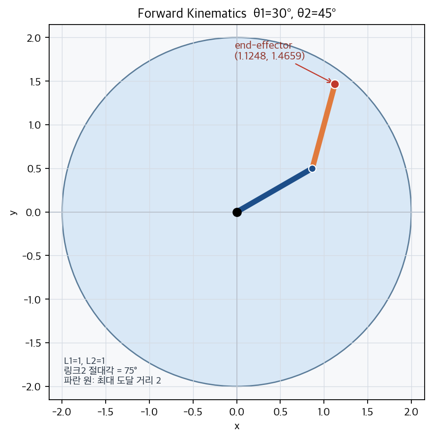
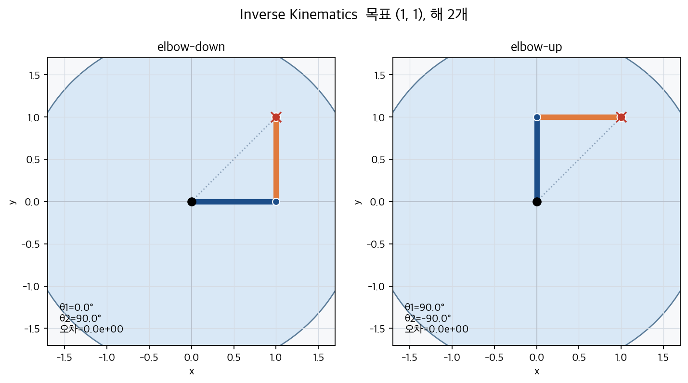
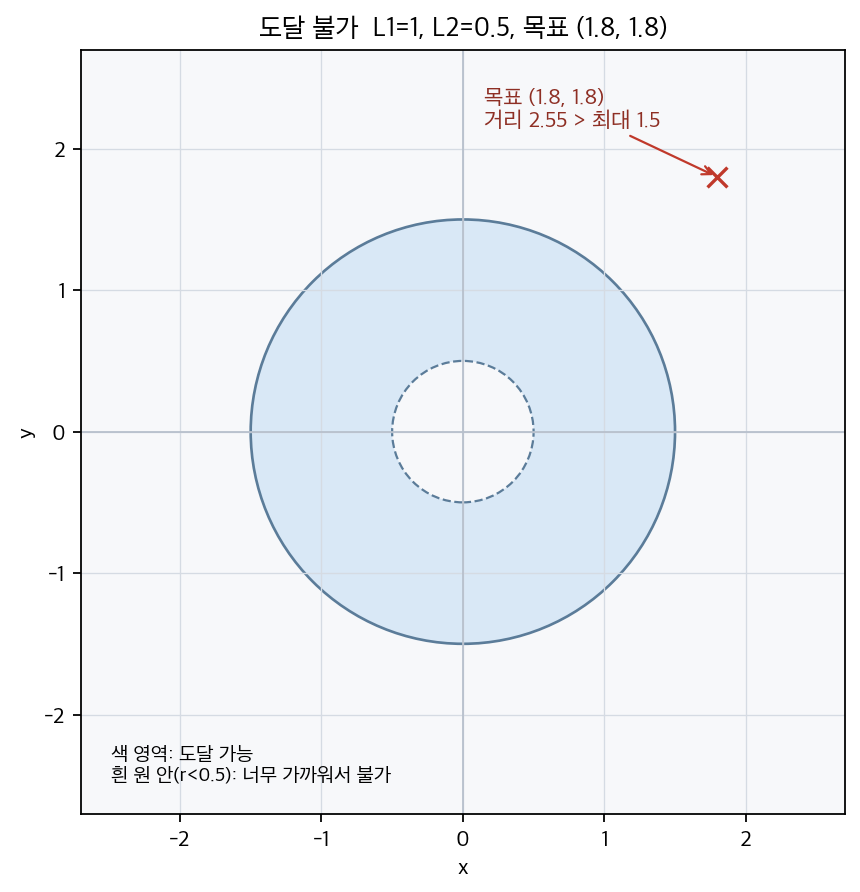
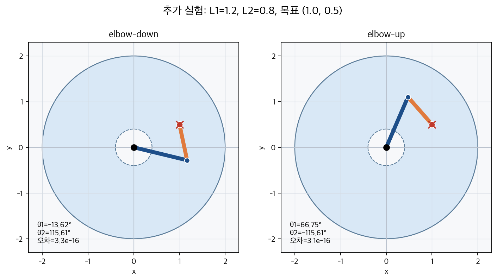
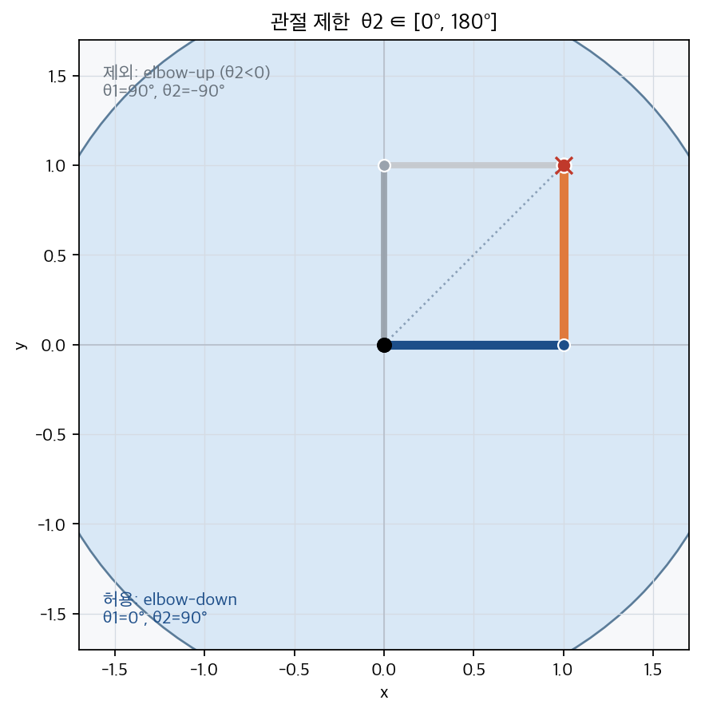
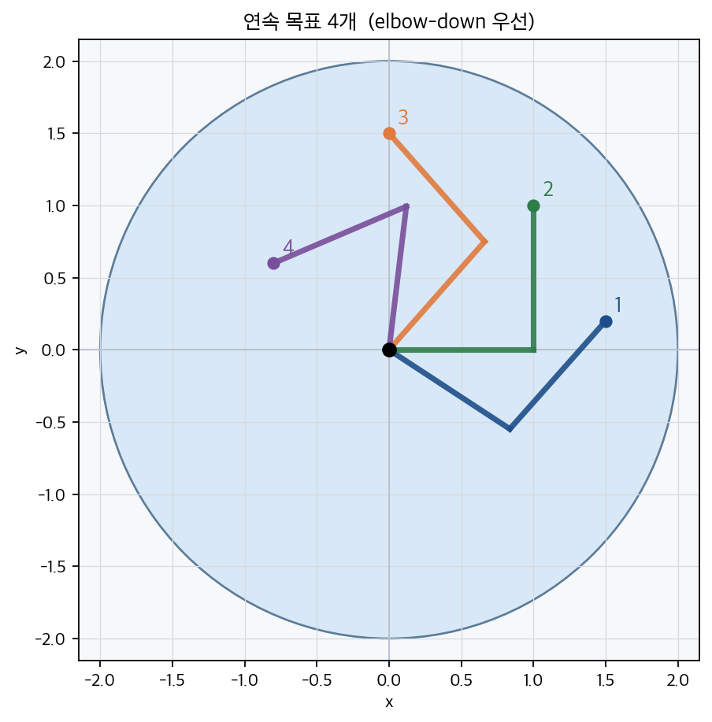
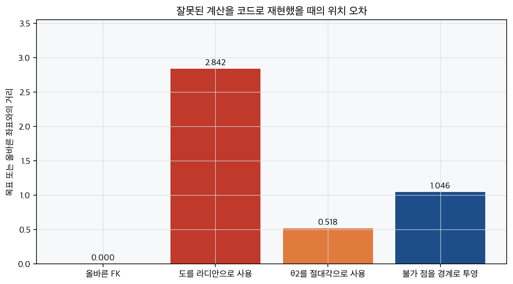

# W2 공통 스터디 — 2-DOF 로봇팔 기구학

2링크 평면 팔의 Forward Kinematics와 Inverse Kinematics를 계산하고, 같은 문제를 여러 모델에 물어본 뒤 numpy로 검증했다.

실행 환경은 Python 3.13.5, numpy 2.3.5, matplotlib 3.10.7이다.

```bash
python3 study/w2_2dof_robot_arm/run_study.py
```

결과 숫자는 `results.json`, 그림은 `figures/`에 다시 저장된다. 핵심 수식은 `robot_2dof.py`, 실험과 그림은 `run_study.py`에 있다.

## 사용한 AI / Agent

| 역할 | 도구 | 한 일 |
| --- | --- | --- |
| 검증 에이전트 | Cursor의 Grok | 수식을 코드로 구현하고, FK 재대입·작업공간·그림까지 한 흐름으로 실행 |
| 비교 모델 | GPT, Claude, Gemini | 같은 기구학 문제를 따로 풀게 한 뒤, 그 숫자를 numpy와 비교 |

비교는 웹사이트의 ChatGPT/Claude/Gemini 창이 아니라 Cursor 안의 해당 모델에 같은 프롬프트를 넣어 수행했다. 아래에 프롬프트가 있으므로, 발표 자료에 웹 화면이 필요하면 그대로 붙여 다시 물을 수 있다.

신뢰의 기준은 모델의 문장이 아니라 다음 두 가지가 서로 일치하는가다.

- 닫힌형 순기구학 식과 numpy 계산
- 서로 다른 두 역기구학 유도(atan2 식, 코사인법칙의 각 φ 식). 도달 가능한 표본 88점에서 관절각이 일치했다.

## 개념 정리

공통 예는 이번 과제의 팔이다. 원점이 어깨, 링크 길이 1과 1, 끝점이 손이다.

### Coordinate Frame

기준점과 축 방향이 정해진 좌표계다. "오른쪽 1, 위 1"이 의미를 가지려면 원점이 어디이고 어느 쪽이 x인지가 먼저 정해져 있어야 한다.

로봇은 부품마다 좌표계가 다르다. 어깨 기준 좌표와 손 기준 좌표를 섞으면 같은 숫자도 다른 점이 된다.

이번 팔은 어깨 관절을 원점, 오른쪽을 +x, 위를 +y로 둔다. 끝점 (1, 1)은 어깨의 오른쪽 1, 위 1이다.

### Position

좌표계 안에서 점의 위치다. 이 평면 팔에서는 (x, y) 두 숫자다.

그리퍼를 컵 앞에 보내려면 위치가 필요하다. 각도만 알아서는 손이 어디에 있는지는 바로 안 나온다.

θ1=0°, θ2=90°이면 손은 (1, 1)이다. 팔꿈치는 (1, 0)이다.

### Orientation

그 점에 놓인 물체가 어느 방향을 보고 있는지다. 평면에서는 각 하나다.

같은 위치라도 컵을 위에서 잡을지, 옆에서 잡을지가 다르다. 이 팔에서 링크 2의 절대각 θ1+θ2를 손의 방향으로 볼 수 있다.

θ1=30°, θ2=45°이면 손은 약 (1.125, 1.466)에 있고, 링크 2는 +x에서 75° 방향을 본다.

### Pose

위치와 방향을 합친 것이다. 평면에서는 (x, y, φ) 세 값이다.

물체를 놓으려면 "어디"와 "어느 방향"이 같이 필요하다.

이 팔의 관절은 2개뿐이다. 평면 pose의 독립 성분은 3개이므로, 손의 (x, y)를 정하면 방향 φ는 따라온다. 방향을 따로 지정하려면 손목 관절이 하나 더 필요하다.

### DOF

자유롭게 움직일 수 있는 독립 변수의 개수다.

목표를 식으로 쓸 때 미지수 개수가 된다. 미지수가 식보다 적으면 못 가는 목표가 생기고, 더 많으면 같은 목표에 해가 여러 개다.

이 팔은 관절각 2개가 독립이므로 2 DOF다. 평면 위치 (x, y)도 2개라서, 도달 가능한 점에는 보통 해가 2개(elbow-up, elbow-down) 나온다.

### Forward Kinematics

관절각을 넣으면 손의 위치가 나오는 계산이다.

모터 각도는 센서가 알려 준다. 그 각도로 손이 어디 있는지는 FK로 바꾼다. IK 답이 맞는지 확인할 때도 FK에 다시 넣는다.

L1=L2=1, θ1=30°, θ2=45°이면

```
x = cos 30° + cos 75° = 1.124844
y = sin 30° + sin 75° = 1.465926
```

### Inverse Kinematics

손의 목표 위치를 넣으면 관절각이 나오는 계산이다.

사람이 지정하는 것은 "손을 (1, 1)에 둬"이지 "θ2를 90°로 둬"가 아니다. 모터에 내릴 값은 각도이므로 IK가 필요하다.

(1, 1)의 해는 (θ1, θ2) = (0°, 90°)와 (90°, -90°) 두 개다. 둘 다 FK에 넣으면 다시 (1, 1)이다.

## 각도 규약

모델을 비교하기 전에 규약을 고정했다. 이걸 안 적으면 같은 30°, 45°도 다른 좌표가 된다.

- 기저는 원점, +x는 오른쪽, +y는 위
- θ1: 링크 1이 +x와 이루는 각. 반시계가 양수
- θ2: 링크 1에 대한 링크 2의 상대각. 반시계가 양수
- 링크 2의 절대각은 θ1+θ2
- 계산은 라디안, 입력과 보고는 도

```
x = L1 cos θ1 + L2 cos(θ1+θ2)
y = L1 sin θ1 + L2 sin(θ1+θ2)
```

θ2의 부호는 팔꿈치 위치와 이렇게 연결된다. 기저에서 목표로 가는 벡터를 T, 기저에서 팔꿈치로 가는 벡터를 E라 하면 T × E = -L1 L2 sin θ2 이다.

- θ2 > 0: elbow-down. 팔꿈치가 목표 반직선의 시계 방향. (1, 1)에서는 대각선 아래, 팔꿈치 (1, 0)
- θ2 < 0: elbow-up. 반시계 방향. (1, 1)에서는 대각선 위, 팔꿈치 (0, 1)
- sin θ2 = 0: 완전히 펴지거나 접힌 특이자세. 해가 하나로 붙는다

elbow-up/down이라는 이름은 교재마다 반대일 수 있다. 발표에서는 이름보다 각도와 팔꿈치 좌표를 같이 말한다.

## 사용한 프롬프트

GPT와 Claude에는 규약을 명시한 뒤 과제 문제를 그대로 물었다. 도구와 코드 실행은 쓰지 말고, 식으로만 풀라고 했다.

```
각도 규약:
- 베이스 원점, +x 오른쪽, +y 위
- θ1은 +x에서 링크 1까지, 반시계 양수
- θ2는 링크 1 기준 링크 2의 상대각, 반시계 양수

A. L1=1, L2=1, θ1=30°, θ2=45°. 끝점 (x, y)와 식의 의미.
B. L1=1, L2=1, 목표 (1, 1). 모든 θ1, θ2. elbow-up / elbow-down.
C. L1=1, L2=0.5, 목표 (1.8, 1.8). 도달 가능한가. 불가면 해를 만들지 말 것.
D. (1, 1)의 해를 FK에 다시 넣고 오차를 계산.
```

Gemini에는 규약을 숨긴 채, 숫자가 딱 떨어지지 않는 문제를 추가로 물었다.

```
Case 1. L1=1, L2=1, 첫 관절 30°, 둘째 관절 45°.
        둘째 각이 상대각인지 절대각인지 스스로 정하고 끝점 계산.
Case 2. 목표 (1.5, 0.5)의 IK를 모두 구하고 FK로 오차 확인.
Case 3. 목표 (1.42, 1.42)는 도달 가능한가.
        작업공간 경계로 투영한 값을 해라고 부르지 말 것.
```

에이전트용 지시는 과제 예시 그대로다. 구현은 `run_agent()`가 같은 순서를 코드로 수행한다.

```
목표 좌표
→ 도달 가능한지 판단
→ θ1, θ2 계산
→ FK로 재검증
→ 목표와의 오차
→ 유효한지 판단
```

## Forward Kinematics

조건: L1=1, L2=1, θ1=30°, θ2=45°.

링크 1은 +x에서 30°이므로 팔꿈치는 (cos 30°, sin 30°) = (0.866025, 0.500000)이다. 링크 2는 그 방향에서 45°를 더해 절대각 75°를 본다.

```
x = √3/2 + (√6 - √2)/4 = 1.124844448887
y = 1/2 + (√6 + √2)/4 = 1.465925826289
```

numpy로 같은 값을 다시 계산했다. `np.cos`에 도를 넣지 않고 `np.radians`로 바꾼 뒤에 넣는다.

```python
lengths = np.array([L1, L2])
absolute = np.array([theta1, theta1 + theta2])  # 라디안
xy = np.array([lengths @ np.cos(absolute), lengths @ np.sin(absolute)])
```

닫힌형 식과 numpy의 차이는 1e-12 이하다.

| 출처 | x | y | numpy와의 거리 |
| --- | ---: | ---: | ---: |
| numpy / 닫힌형 | 1.124844449 | 1.465925826 | 0 |
| GPT | 1.124844449 | 1.465925826 | 3.1e-10 |
| Claude | 1.124844 | 1.465926 | 4.8e-7 |
| Gemini (소수 4자리로 보고) | 1.1248 | 1.4659 | 5.1e-5 |

세 모델 모두 상대각 규약과 `cos(θ1+θ2)`를 썼고, 보고한 자릿수 안에서 numpy와 같다. Gemini 본문에는 1.124844, 1.465926이라고도 적혀 있고, 마지막 요약만 소수 4자리였다.



## Inverse Kinematics

목표 (1, 1), L1=L2=1.

목표까지 거리 √2 ≈ 1.414214는 작업공간 [0, 2] 안이다.

```
cos θ2 = (x² + y² - L1² - L2²) / (2 L1 L2) = 0
θ2 = ±90°
θ1 = atan2(y, x) - atan2(L2 sin θ2, L1 + L2 cos θ2)
```

| 자세 | θ1 | θ2 | 팔꿈치 | FK 재대입 | 오차 |
| --- | ---: | ---: | --- | --- | ---: |
| elbow-down | 0° | 90° | (1, 0) | (1, 1) | 0 |
| elbow-up | 90° | -90° | (0, 1) | (1, 1) | 0 |

GPT, Claude, Gemini 모두 이 두 해를 제시했고, (1.8, 1.8) / L2=0.5는 도달 불가로 판단했다. 해 하나만 내거나, 불가 점의 각도를 만들어 내지는 않았다.



완전히 편 목표 (0, 2)는 해가 하나다. θ1=90°, θ2=0°. 같은 길이의 팔을 원점까지 접으면 θ2=±180°이고 θ1은 어떤 값이든 된다. 이때 IK 식의 `atan2(y, x)`는 방향이 없으므로, 코드는 대표해 하나만 반환하고 그 사실을 문장으로 남긴다.

## Python으로 검증하는 방법

`robot_2dof.py`가 기준 구현이다. 각도는 함수 안에서만 도로 받고, 삼각함수에 들어가기 전에 라디안으로 바꾼다.

역기구학은 두 벌이다.

1. `cos θ2`로 θ2를 구하고, `atan2`로 θ1을 구한다.
2. 목표 방향각 α에서 링크 1이 벗어난 각 φ를 더하거나 뺀다. elbow-down은 α-φ, elbow-up은 α+φ.

2번은 1번의 검산용이다. 그리드 위의 도달 가능 점 88곳에서 두 식의 각도가 1e-8 라디안 이내로 같았다. 각 해는 FK에 다시 넣어 위치 오차가 1e-8 이하인지도 확인한다.

도달 판정은 `|L1-L2| ≤ √(x²+y²) ≤ L1+L2` 와 `|cos θ2| ≤ 1`을 같이 본다. 범위를 벗어나면 관절각을 만들지 않는다.

## 추가 실험

과제에서 고르라고 한 항목 중 네 가지를 했다. 링크 길이 변경, 다른 목표, 도달 불가, 관절 범위, 연속 목표.

### 1. 도달 불가 — L1=1, L2=0.5, 목표 (1.8, 1.8)

거리 2.545584. 이 팔은 0.5 이상 1.5 이하만 도달한다. `cos θ2 = 5.23`이라 실수 해가 없다. 에이전트는 각도를 반환하지 않았다.



### 2. 링크 길이와 목표를 변경 — L1=1.2, L2=0.8, 목표 (1.0, 0.5)

작업공간은 0.4 이상 2.0 이하이고, 목표 거리는 1.118이다.

| 자세 | θ1 | θ2 | 오차 |
| --- | ---: | ---: | ---: |
| elbow-down | -13.617737° | 115.613083° | 3.3e-16 |
| elbow-up | 66.747839° | -115.613083° | 3.1e-16 |

길이가 달라도 해는 두 개이고, FK 오차는 수치 오차 수준이다.



같은 팔 L1=L2=1로 목표만 (0.2, 1.6)으로 바꾼 경우도 확인했다. 거리 1.612452.

| 자세 | θ1 | θ2 | 오차 |
| --- | ---: | ---: | ---: |
| elbow-down | 46.603785° | 72.542397° | 5.0e-16 |
| elbow-up | 119.146182° | -72.542397° | 2.8e-16 |

### 3. 관절 제한 — θ2는 0° 이상 180° 이하

(1, 1)은 기하학적으로 해가 두 개다. θ2=-90°인 elbow-up은 범위 밖이라 제외된다. 명령으로 쓸 수 있는 해는 elbow-down (0°, 90°) 하나다. 위치 오차가 0인 것과, 모터가 그 각을 낼 수 있는 것은 따로 확인해야 한다.



### 4. 연속 목표

L1=L2=1, elbow-down만 골랐다. 네 점 모두 오차가 1e-15 이하다.

| 순서 | 목표 | θ1 | θ2 |
| ---: | --- | ---: | ---: |
| 1 | (1.5, 0.2) | -33.236717° | 81.662721° |
| 2 | (1.0, 1.0) | 0° | 90° |
| 3 | (0.0, 1.5) | 48.590378° | 82.819244° |
| 4 | (-0.8, 0.6) | 83.130102° | 120° |



## Agent 흐름

`run_agent()`는 모델에게 긴 문장을 다시 시키지 않는다. 목표 좌표가 들어오면 아래 순서를 항상 같은 코드로 수행한다.

(1, 1), L1=L2=1:

```
[Agent] 목표 (1.000000, 1.000000), L1=1, L2=1
1. 도달 판단: 거리 1.414214, 작업공간 [0.000000, 2.000000]
   도달 가능. 기하학 해 2개.
2-4. 해 1 [elbow-down] θ1=0.000000°, θ2=90.000000°
   FK 재계산 (1.00000000, 1.00000000), 위치 오차 0.000e+00, 유효=예
2-4. 해 2 [elbow-up] θ1=90.000000°, θ2=-90.000000°
   FK 재계산 (1.00000000, 1.00000000), 위치 오차 0.000e+00, 유효=예
5. 결과: 유효한 해 2개.
```

(1.8, 1.8), L2=0.5:

```
1. 도달 판단: 거리 2.545584, 작업공간 [0.500000, 1.500000]
   cos(theta2)=5.230000 는 [-1, 1] 밖
5. 결과: 도달 불가. 관절각을 만들지 않습니다.
```

θ2를 0°~180°로 제한하면 elbow-up의 FK 오차는 0이지만 `유효=아니오`가 된다. 오차만 보면 둘 다 맞고, 제한까지 봐야 하나다.

## AI 비교

비교 항목은 계산 정확도, 식, 해의 개수, 도달 불가 판단, 설명에서 규약을 밝혔는지다.

| 항목 | numpy | GPT | Claude | Gemini |
| --- | --- | --- | --- | --- |
| FK 식 | cos(θ1)+cos(θ1+θ2) | 동일 | 동일 | 상대각을 스스로 선택, 동일 |
| FK 숫자 | 1.124844449, 1.465925826 | 자릿수 안 일치 | 자릿수 안 일치 | 소수 4자리로 일치 |
| (1, 1) 해 | 2개, 0°/90°, 90°/-90° | 2개, 동일 | 2개, 동일 | 동일 규약 |
| elbow 설명 | 아래 (1,0) / 위 (0,1) | 동일 | 동일. 이름 규약이 흔들릴 수 있다고 밝힘 | 동일 |
| (1.8, 1.8), L2=0.5 | 불가, cos=5.23 | 불가, 해 없음 | 불가, 해 없음 | 별도 경계 문제도 불가 |
| FK 재검증 | 오차 0 | 오차 0 | 오차 0 | 각도 재대입 오차 1.3e-7 |

Gemini의 추가 문제 (1.5, 0.5)도 코드와 소수 4자리까지 같다.

| | elbow-down | elbow-up |
| --- | --- | --- |
| numpy | θ1=-19.326295°, θ2=75.522488° | θ1=56.196193°, θ2=-75.522488° |
| Gemini | -19.3263°, 75.5225° | 56.1962°, -75.5225° |

보고된 각도를 FK에 다시 넣으면 (1.5, 0.5)와의 거리는 1.34e-7이다. 작업공간 바로 밖인 (1.42, 1.42)는 거리 2.008183 > 2 라서 불가다. Gemini도 해를 만들지 않았다.

규약을 명시한 질문에서 세 모델은 식, 해의 개수, 불가 판단을 맞혔다. 차이는 보고 자릿수와, 검산 중간 숫자를 얼마나 그대로 적는지에 있었다. 설명 이해도는 Claude가 elbow 이름의 모호함을 먼저 말한 점이 분명했다. 틀린 답을 자신 있게 단정한 경우는, 아래 중간 산수 한 건이다. 최종 각 자체는 맞았다.

## AI가 틀린 곳, 그리고 코드로 재현한 실패

### 실제로 나온 오류: 검산 중간 값을 합에 맞춰 적음

Gemini는 (1.5, 0.5)의 elbow-down 각 -19.3263°, 75.5225°를 FK로 검산하며 y를 이렇게 적었다.

```
sin(-19.3263°) + sin(56.1962°) ≈ -0.33092 + 0.83092 = 0.50000
```

같은 각을 numpy에 넣으면

```
sin(19.3263°) = 0.33094758
sin(56.1962°) = 0.83094757
합 = 0.49999999
```

각 항이 약 2.76e-5씩, 서로 반대 방향으로 어긋나 있다. 그래서 합은 0.50000으로 보인다. 중간 삼각함수를 표시 합에 맞춰 고친 것이다.

왜 틀렸는지: 최종 위치가 0.5라는 결론을 먼저 두고, 그 합이 딱 떨어지도록 가산수를 조정했다.

어떻게 검증했는지: 모델이 적은 각도를 `math.sin`에 넣고, 적은 가산수와 비교했다. 각 자체는 코드의 -19.326295°, 75.522488°와 소수 4자리에서 같다. 그 각의 위치 오차는 1.34e-7이라 답은 쓸 수 있다. 틀린 것은 과정에 인쇄된 중간 값이다.

더 나은 질문:

```
검산의 sin/cos는 반올림 전 값을 6자리 이상 그대로 적어라.
합이 보기에 딱 떨어지지 않아도 가산수를 맞추지 마라.
오차는 그 각을 FK에 넣은 점과 목표의 거리로만 보고해라.
```

### 규약을 밝혔기 때문에 이번엔 안 나온 실패

세 모델은 degree/radian을 섞거나, θ2를 절대각으로 쓰거나, 불가 점을 경계에 붙여 해를 만들지 않았다. 프롬프트에 상대각과 "불가면 해를 만들지 마라"가 있었기 때문이다. 그 실패가 결과에 얼마나 큰지는 같은 함수에 일부러 넣어서 재었다.

| 잘못된 계산 | 나온 점 | 거리 오차 |
| --- | --- | ---: |
| 올바른 FK | (1.124844, 1.465926) | 0 |
| 30°, 45°를 라디안인 것처럼 cos에 전달 | (1.076003, -1.375813) | 2.842 |
| θ2를 +x 기준 절대각으로 사용. cos 45°를 더함 | (1.573132, 1.207107) | 0.518 |
| (1.8, 1.8)에서 cos θ2=5.23을 1로 잘라 완전 신장 | (1.060660, 1.060660), 각 45°/0° | 1.046 |



도를 그대로 넣으면 오차가 2.84로 가장 크다. numpy와 math의 삼각함수는 라디안이다. 절대각 실수는 식이 한 기호만 달라도 0.52가 벌어진다. 불가 점을 억지로 투영하면 각은 멀쩡해 보여도 목표는 1.05 밖에 있다. FK 재대입이 이 마지막 경우를 잡는다.

해 개수는 위치 오차만으로 안 잡힌다. (0°, 90°)만 반환해도 그 해의 오차는 0이다. (1, 1)에서 해가 2개인지, 관절 제한을 통과하는지는 따로 세야 한다. 코드 테스트는 해 개수가 2가 아니면 실패하게 해 두었다.

### 길이 같을 때만 되는 지름길

Gemini는 L1=L2일 때 θ1을 `atan2(y, x) - θ2/2`로 구했다. (1.5, 0.5)에서는 이등변삼각형이라 맞고, 코드 각도와 소수 4자리가 일치한다. 모델도 "길이가 같으므로"라고 조건을 적었다.

그 식을 L1=1.2, L2=0.8, 목표 (1.0, 0.5)에 그대로 쓰면 θ1이 -13.62°가 아니라 -31.24°가 되고, 손 위치는 목표에서 0.343 벗어난다. L1=1, L2=0.5, 목표 (1.2, 0.2)에서도 오차는 0.313이다.

더 나은 질문:

```
θ1 = atan2(y,x) - θ2/2 가 L1≠L2일 때도 성립하는지
L1=1.2, L2=0.8, 목표 (1, 0.5)로 확인하고,
성립하지 않으면 일반식을 써라.
```

일반식은 `atan2(y, x) - atan2(L2 sin θ2, L1 + L2 cos θ2)` 이다.

## 느낀 점 / 개선

모델은 규약을 문장으로 주면 이 2링크 문제를 잘 푼다. 믿을 구간은 "식이 교과서와 같고, FK에 다시 넣었을 때 오차가 1e-6 아래이며, 불가 점에서는 각도를 안 낸다"까지다. 중간 산수가 깔끔해 보이는 것은 그 기준에 들어가지 않는다. Gemini 검산처럼 합만 맞고 가산수는 틀릴 수 있다.

다음에 같은 실험을 하면 프롬프트에 네 가지를 고정한다.

1. θ2가 상대각인지 절대각인지
2. 해를 전부 내고, 각 해의 팔꿈치 좌표를 적을 것
3. `|cos θ2| > 1`이면 각도를 만들지 말 것
4. 검산 오차는 재대입한 좌표의 거리만 쓸 것

판단 자체는 모델 문장이 아니라 `run_agent()` 같은 짧은 코드에 둔다. 모델은 식과 설명을 가져오고, 통과 여부는 코드가 정한다.

## 발표 구성 (20분, 3명)

화면에 코드 전체를 띄우기보다, 프롬프트 → 모델 답 → 그림 → numpy 오차 순서로 간다.

| 시간 | 담당 | 화면 | 말할 내용 |
| ---: | --- | --- | --- |
| 4분 | A. 개념 | 규약 네 줄과 DOF | 좌표계가 있어야 (1,1)이 의미가 있다. 이 팔은 2 DOF라 위치는 정할 수 있고 방향은 따라온다. θ2는 상대각이다. |
| 3분 | B. FK | `01_fk_30_45.png` | 30°+45°라 링크 2의 절대각은 75°. 식 두 줄. 세 모델과 numpy가 자릿수 안에서 같다. |
| 4분 | B. IK | `02_ik_1_1.png` | 해가 두 개. 팔꿈치 (1,0)과 (0,1). 둘 다 FK 오차 0. 해 하나만 맞으면 오차 검증은 통과하므로 개수를 따로 센다. |
| 3분 | C. 추가 실험 | `03`, `04`, `05` | (1.8, 1.8)은 거리 2.55 > 1.5. 길이를 바꿔도 오차는 1e-16. θ2≥0 제한이면 elbow-up은 오차가 0이어도 버린다. |
| 3분 | C. AI 비교 | 비교 표 | 규약을 적었더니 식과 해 개수, 불가 판단은 세 모델이 맞았다. 차이는 보고 자릿수와, elbow 이름이 교재마다 다를 수 있다고 Claude가 먼저 말한 점. |
| 3분 | A. 오류와 느낀 점 | `07_error_modes.png` | Gemini 중간 sin이 2.8e-5씩 반대로 어긋났다. 각도는 맞다. 도를 라디안으로 넣으면 오차 2.84. 결론은 모델이 설명하고 코드가 통과시킨다. |
